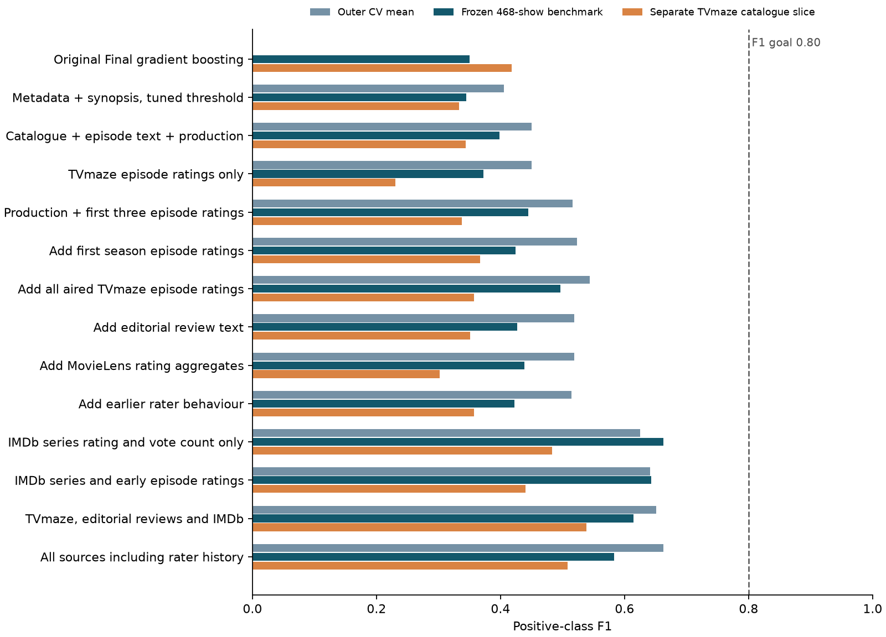

# Can audience information improve TVmaze rating classification?

**Bekzat Rashiduly · Follow-up to the TVmaze course experiment**

The original Final compared metadata and synopses on 2,339 series. This follow-up keeps the target **TVmaze rating ≥ 8/10**, the original show IDs and folds, then adds production data, episode plots and audience information. It asks how performance changes once those sources are available for a released series.

The public-input model selected by training cross-validation was **Add all aired TVmaze episode ratings**. Its F1 on the same 468 series changed from **0.350 to 0.497**. The paired stratified bootstrap interval for the difference was **[+0.050, +0.241]**. The training-selected local IMDb experiment reached **0.583**. The highest observed benchmark score was **0.663** for **IMDb series rating and vote count only**. This is a descriptive maximum across tried variants. The training-selected model was already frozen. Every result stayed below the 0.80 F1 target on the full frozen benchmark.

## What was added

- **TVmaze episodes and credits.** Exact `show_id` join. 2,339 details records, 2,086 series with text from the first three episodes, 1,721 with ratings on those episodes and 1,775 with at least one rated episode in season one. Text uses frozen MiniLM. The original TVmaze show rating remains the target. Episode scores come from separate episode voting. Cast and crew features summarize outcomes of other shows in the fitting partition, with three-fold cross-fitting to build training features.
- **Editorial review text.** 33 Celluloid matches by unique normalized title and premiere year, with the linked article, byline and a last-updated date through 6 October 2026. The text block excludes score-bearing sentences and the separate verdict sections. This is sparse coverage from one byline.
- **Rater history.** MovieTweetings matches 1 series. MovieLens 32M covers 106 series with 24,389 events from 15,380 pseudonymous raters. For 24,011 of those ratings, at least ten strictly earlier ratings give a personal reference mean. A relative rating subtracts that mean from the current value. The model uses only per-series aggregates, with no individual user IDs. The benchmark contains 18 MovieLens-covered titles (4 positive).
- **Local IMDb comparison.** Exact IMDb ID joins cover 2,293 series, including 2,276 with ratings on at least one of the first three episodes. Aggregate rating and vote count come from the official downloadable datasets. Information courtesy of IMDb ([IMDb](https://www.imdb.com)). Used for individual non-commercial analysis under its terms. Title-level IMDb files and fitted IMDb-dependent model binaries stay local.

## Evaluation

Each candidate and its F1 decision threshold were selected from inner validation predictions. The five outer folds use saved training IDs. A final five-fold search freezes the candidate and threshold before reading the 468-series results. The original Final gradient boosting is included at its originally reported threshold, while the catalogue row controls for adding threshold tuning and the new model search. Read an input block's change against its nearest control. The exact fold and threshold tables are included.

| Input configuration | Outer CV F1 mean ± SD | Test F1 | Test precision | Test recall | Separate slice F1 |
| --- | ---: | ---: | ---: | ---: | ---: |
| Original Final gradient boosting | 0.402 ± 0.031 | 0.350 | 0.256 | 0.556 | 0.418 |
| Metadata + synopsis, tuned threshold | 0.406 ± 0.039 | 0.345 | 0.261 | 0.506 | 0.333 |
| Catalogue + episode text + production | 0.450 ± 0.033 | 0.398 | 0.323 | 0.519 | 0.344 |
| TVmaze episode ratings only | 0.450 ± 0.035 | 0.373 | 0.309 | 0.469 | 0.230 |
| Production + first three episode ratings | 0.516 ± 0.026 | 0.444 | 0.365 | 0.568 | 0.338 |
| Add first season episode ratings | 0.523 ± 0.018 | 0.424 | 0.417 | 0.432 | 0.367 |
| Add all aired TVmaze episode ratings | 0.544 ± 0.048 | 0.497 | 0.513 | 0.481 | 0.357 |
| Add editorial review text | 0.519 ± 0.023 | 0.427 | 0.422 | 0.432 | 0.351 |
| Add MovieLens rating aggregates | 0.519 ± 0.037 | 0.438 | 0.492 | 0.395 | 0.302 |
| Add earlier rater behaviour | 0.514 ± 0.029 | 0.422 | 0.425 | 0.420 | 0.357 |
| IMDb series rating and vote count only | 0.625 ± 0.042 | 0.663 | 0.600 | 0.741 | 0.483 |
| IMDb series and early episode ratings | 0.641 ± 0.048 | 0.643 | 0.611 | 0.679 | 0.441 |
| TVmaze, editorial reviews and IMDb | 0.651 ± 0.047 | 0.614 | 0.600 | 0.630 | 0.538 |
| All sources including rater history | 0.662 ± 0.087 | 0.583 | 0.543 | 0.630 | 0.508 |

The public model changes precision from **0.256 to 0.513** and recall from **0.556 to 0.481**. It recovers fewer positives and produces a much shorter list of false positives. Its confusion counts on the 468 shows are 350 true negatives, 37 false positives, 42 false negatives and 39 true positives.

The episode-only and IMDb-only rows measure two sources of audience signal separately. Against its direct benchmark control, the first-three episode block changes F1 by **+0.046**. Editorial review text changes it by **+0.003**, and relative reviewer behaviour changes it by **-0.016** after the ordinary MovieLens rating aggregates. Each row reselects its method and decision threshold from training folds. These differences measure pipelines, with uncertainty and sparse source coverage discussed in `paired_ablation.csv` and `coverage_metrics.csv`.

The additional catalogue slice consists of **271 different TVmaze IDs (24 positives)** from fixed index pages 60–99. Exact IMDb duplicates and title-year overlaps with the old index were removed. The previously frozen models were applied without recalibration. The public model reached **0.357** there, versus **0.418** for the original Final model. The local IMDb-assisted model reached **0.508**.

The two cohorts have different positive shares, 17.3% in the frozen benchmark and 8.9% in the separate slice. The public model's benchmark gain did not carry over to the other catalogue. Differences in release mix, rating participation and class prevalence matter when applying a fixed threshold. This is why the extension reports both evaluations.

## Examples from the unchanged test set

- **Fargo** (repaired false negative). Observed show rating 8.6. Mean observed episode rating 8.14 over 51 rated episodes. The new model score moves from 0.850 to 0.361 when its episode ratings are masked. The decision threshold is 0.653.
- **Resurrection** (repaired false positive). Observed show rating 7.1. Mean observed episode rating 5.60 over 21 rated episodes. The new model score moves from 0.152 to 0.255 when its episode ratings are masked. The decision threshold is 0.653.
- **Sherlock** (new false negative). Observed show rating 8.9. Mean observed episode rating 8.09 over 12 rated episodes. The new model score moves from 0.531 to 0.479 when its episode ratings are masked. The decision threshold is 0.653.
- **The Walking Dead** (new false positive). Observed show rating 7.9. Mean observed episode rating 7.93 over 177 rated episodes. The new model score moves from 0.810 to 0.269 when its episode ratings are masked. The decision threshold is 0.653.

These examples display both repairs and newly introduced errors. Episode ratings are observations about episodes. The model and audience can disagree on the overall show score even when episodes rate highly.

## Scope of the result

Episode and IMDb votes were retrieved in November. The course target is an October snapshot. The sources can include votes cast after that date, and the public API does not supply their historical per-episode vote timestamps. These numbers measure retrospective catalogue classification using audience information. The second slice checks transfer to other catalogue entries using current ratings. A genuine forecast after the first three episodes would require archived input scores at a declared cutoff and show ratings from a later date. Catalogued cast/crew and season structure can also change after premiere.

The original synopsis hypothesis remains a separate content-only comparison. New audience signals can be informative without supporting a conclusion about synopsis quality. Coverage by platform and show popularity can bias audience inputs. The reused 468-row test, related franchises, and limited review coverage bound generalisation claims.



## Reproduce and demonstrate

First install the Final Python environment and extract `data_snapshot.zip`, `final_artifacts.zip` and `audience_artifacts.zip`.

```bash
python code/predict_audience.py --show-id 2
python code/verify_audience.py
python code/audience_experiment.py --lens data/audience/movielens_aggregate.csv --out results/audience_public_reproduction
```

The final command reruns the public variants. The complete audience run also takes `--local-imdb` pointing to the file prepared locally from IMDb. `training_selection.json`, `outer_cv.csv`, `tuning.csv`, `coverage_metrics.csv` and `transfer_metrics.json` contain the evidence. Licensed source snapshots and aggregates are in `data/audience`.

For the oral defence: “The earlier experiment tested information inside the synopsis. Here I tested evidence from audiences after release. I used the same test IDs and tuned the threshold only inside training folds. I then applied the frozen model to a second set of shows. The audience-assisted score describes a different information setting from predicting a new series before anyone has watched it.”

## Sources and licences

- [TVmaze API](https://www.tvmaze.com/api). TVmaze data and derived episode/credit projections, CC BY-SA. [Separate episode voting](https://www.tvmaze.com/blogs/30/voting-on-episodes-from-episode-list-now-possible).
- [Celluloid review data](https://celluloidscore.com/about/data/), CC BY 4.0. Review excerpts were matched by title and year, trimmed and screened. Title links, article links, update dates and author attribution accompany the retained records.
- [MovieLens 32M](https://grouplens.org/datasets/movielens/32m/) under the [GroupLens research licence](https://files.grouplens.org/datasets/movielens/ml-32m-README.html). F. Maxwell Harper and Joseph A. Konstan. 2015. [The MovieLens Datasets: History and Context](https://doi.org/10.1145/2827872). All published features aggregate interactions by series.
- [MovieTweetings](https://github.com/sidooms/MovieTweetings), MIT. Coverage audit only; no account mappings collected.
- [IMDb non-commercial datasets](https://data.imdb.com/non-commercial-datasets/) and [terms for software use](https://help.imdb.com/article/imdb/general-information/can-i-use-imdb-data-in-my-software/G5JTRESSHJBBHTGX). Only aggregate evaluation metrics are reported in public.

See the [training-set expansion](AUDIENCE_SCALEUP.md) for a later test on a third catalogue slice.
