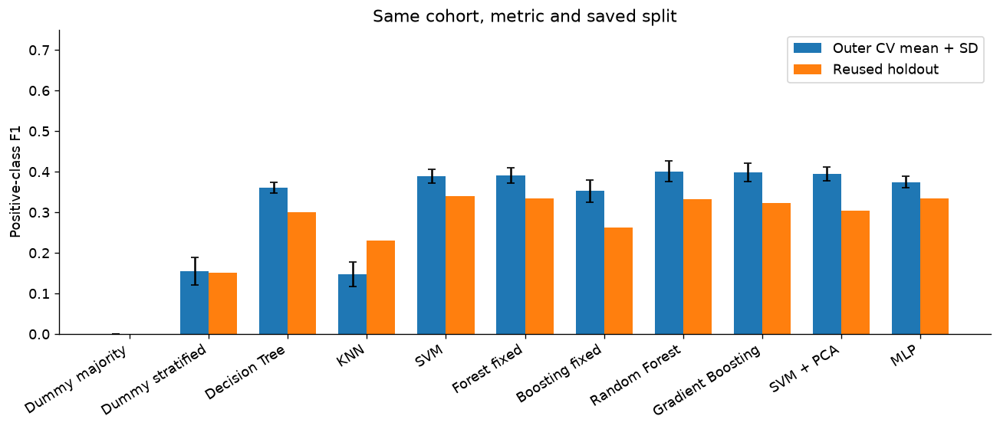
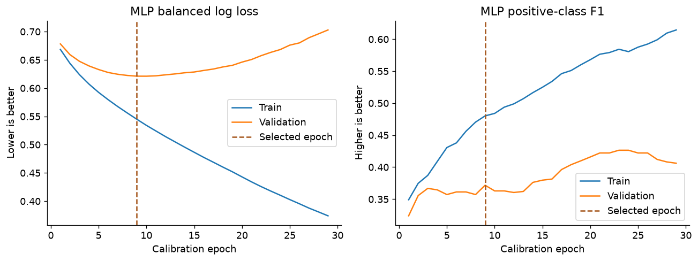
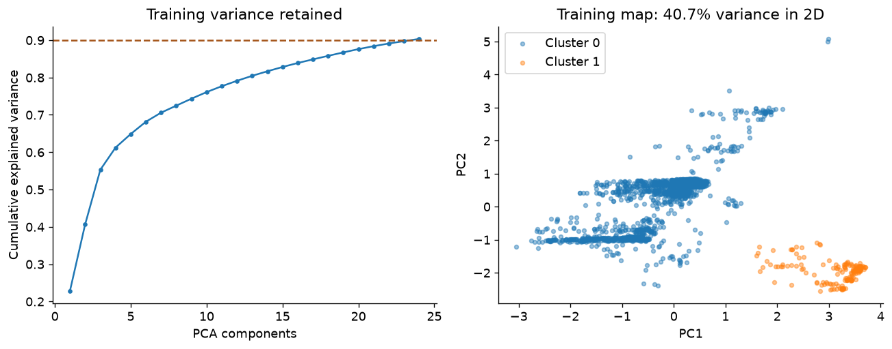

# TV series classification from metadata

A reproducible study of whether structured TVmaze metadata can identify series rated at least 8/10. The repository compares tuned tree ensembles and a small neural network with an SVM benchmark, and investigates what PCA and clustering actually reveal about the catalogue.

The main result is a modest signal and a useful negative finding: higher cross-validation F1 did not translate into a higher score on the reused holdout. The project preserves that result rather than selecting a winner from test scores.



## Data and target

- 2,339 English-language scripted series, including 404 positives (17.3%). One row is one series.
- Collected with the supplied public-API collector on 6 October 2026. Raw JSON, collection timestamps and SHA-256 hashes are preserved.
- Target: `rating >= 8`. The observed rating is used only to create the label and never enters the predictors.
- Inputs: premiere year, episode runtime, channel, web platform, broadcaster/platform country, distribution and genres. Titles, IDs, popularity, status and plot summaries are excluded.
- Frozen split: 1,871 train / 468 test, with five saved stratified training folds. Plot text is retained for a later same-object comparison.

## Evaluation

Both ensemble families use eight declared configurations. Each saved outer fold contains an independent three-fold inner search. A separate full-training five-fold search selects final parameters. Preprocessing and class balancing happen within each fit. The main comparison reports nested outer estimates for tuned ensembles and the same outer folds for fixed methods.

The MLP uses an internal training-only validation split to select its epoch count, then retrains from scratch on all supplied training rows. Numeric-library threads and random seeds are fixed. The notebook discloses a tied-neighbour numerical sensitivity in the older KNN benchmark.

| Model | Outer CV F1 mean +/- SD | Test F1 | Test ROC-AUC |
|---|---:|---:|---:|
| Dummy stratified | 0.155 +/- 0.034 | 0.150 | 0.488 |
| Decision Tree | 0.361 +/- 0.013 | 0.300 | 0.563 |
| KNN | 0.147 +/- 0.031 | 0.231 | 0.647 |
| SVM | 0.389 +/- 0.017 | 0.340 | 0.643 |
| Random Forest | 0.401 +/- 0.025 | 0.332 | 0.629 |
| Gradient Boosting | 0.398 +/- 0.023 | 0.322 | 0.639 |
| SVM + PCA | 0.395 +/- 0.016 | 0.305 | 0.626 |
| MLP | 0.374 +/- 0.014 | 0.335 | 0.625 |

Random Forest is selected by outer CV F1. Its held-out F1 is 0.332, compared with SVM 0.340. These small differences and overlapping fold variation do not establish a broad superiority claim. Positive-class F1 is primary because a majority predictor obtains about 83% accuracy without finding any positives.

## Learning and structure



The MLP validation loss bottoms near epoch 9 while fitting loss keeps falling. Early stopping limits this overfitting; the network does not beat the best earlier method on outer CV.



PCA retains 24/77 encoded dimensions for 90.3% variance. The two-dimensional map shows only 40.7%. K-Means selects two groups by silhouette (0.428), stable across the checked initialisations (ARI 1.0). One group mainly reflects missing runtime and streaming distribution. It is a metadata regime, not a proven quality category. A fold-fitted SVM+PCA ablation and group-level errors connect the unsupervised analysis to prediction.

## Run from a fresh clone

Python 3.12 was tested. The immutable source snapshot is compressed to keep the repository compact. No authentication or network request is needed after dependency installation.

```bash
python -m venv .venv
source .venv/bin/activate
python -m pip install -r requirements-endterm.txt
python -m zipfile -e data_snapshot.zip .
python code/run_notebook.py
```

On Windows use `.venv\Scripts\activate` for activation. Open the executed notebook on GitHub, or open the generated `Endterm_TVSeries.html` locally. Full recalculation takes several minutes on a laptop and uses no cached model scores.

## Files

- `Endterm_TVSeries.ipynb`: executed study with decisions, searches, learning checks and actual errors.
- `code/collect_data.py`: API collection and snapshot integrity.
- `code/project.py`: original cleaning, frozen split and benchmark models.
- `code/endterm.py`: nested tuning, validation-controlled MLP and structure analysis.
- `code/run_notebook.py`: fresh-kernel execution and HTML export.
- `data_snapshot.zip`: raw/cleaned data, saved split and original benchmark results.
- `model_comparison.csv`: complete model and metric table.

## Limits and next experiment

This is a finite early-index sample of rated English series. Ratings are subjective and vote counts are unavailable. Current channel fields do not guarantee release-time context. The hard 8/10 boundary separates near-identical ratings, franchises may cross partitions, and the holdout was already reported in the earlier stage. These results do not validate predictions for future or unrated shows.

The next experiment will fit text vocabulary and IDF on training rows only, compare metadata-only / plot-only / combined variants, and preserve the exact object IDs, labels and test split. Any plot-text benefit remains a hypothesis.

## Source and data license

Data: [TVmaze public API](https://www.tvmaze.com/api), snapshot 6 October 2026, licensed under [CC BY-SA 4.0](https://creativecommons.org/licenses/by-sa/4.0/). Cleaned data strip summary HTML, select eligible rows and add a binary label. Attribution and ShareAlike apply to redistribution of these data. See `DATA_LICENSE.txt`. The data license is not a separate software license grant.
