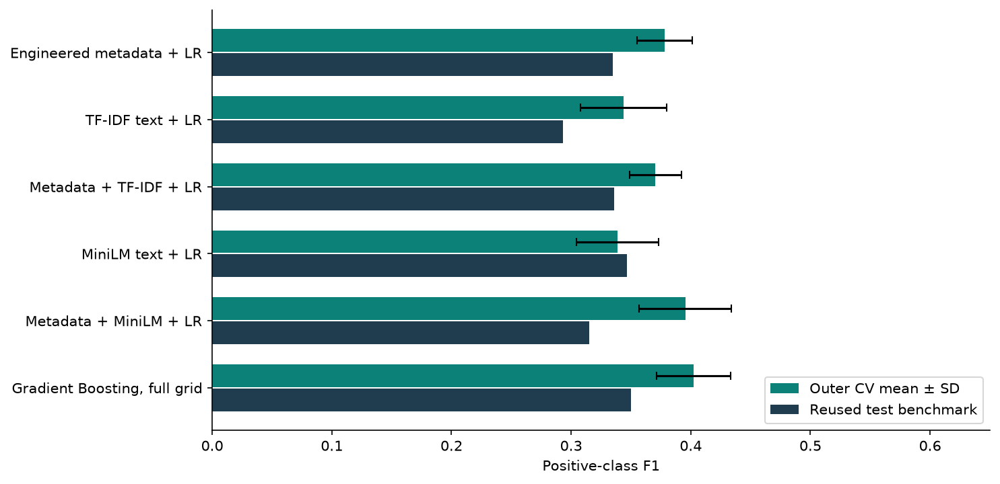
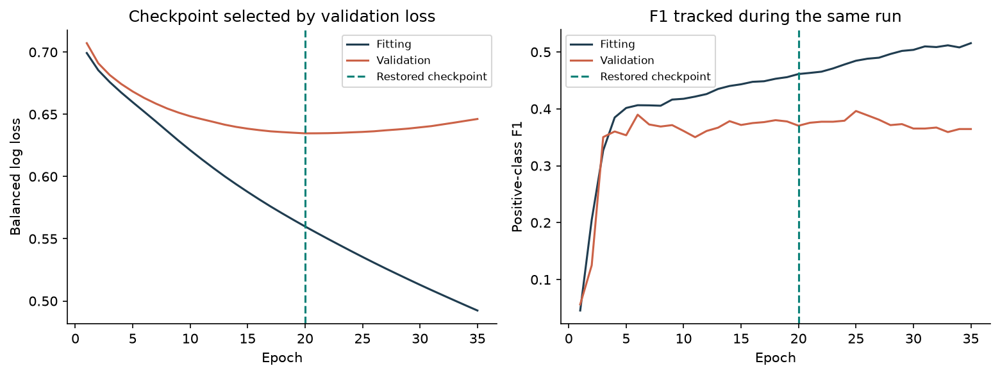
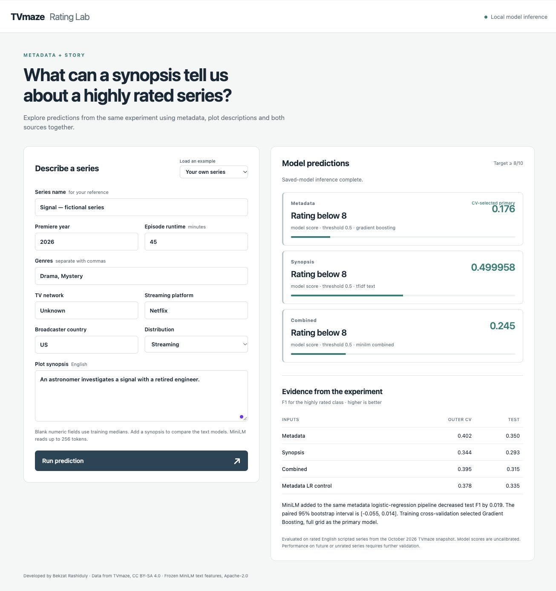

# TVmaze: can a synopsis improve rating classification?

**[Bekzat Rashiduly](https://github.com/gojosatorukz) — an individual ML experiment developed from an Astana IT University course project.** I own the technical development: data collection, hypotheses, implementation, evaluation and the local prediction app. The course presentation is delivered with classmates.

The question is specific: **does a series synopsis improve prediction of a TVmaze rating ≥8/10 when structured metadata are already available?** I compare metadata-only, text-only and combined pipelines on the same saved objects and splits, including a simple learned TF-IDF baseline and a frozen pretrained MiniLM encoder.

For this cohort, split and training protocol, adding frozen MiniLM synopsis features does not demonstrate a reliable F1 improvement over metadata. Controlled test F1 falls from 0.335 to 0.315, and the paired interval includes zero. Text changes individual decisions in both useful and harmful directions. The training-CV-selected Gradient Boosting remains the primary saved model at test F1 0.350. The finding concerns the tested representations and reused benchmark; a new temporal or franchise-grouped evaluation is needed before extending the claim to unseen series.



## Audience reception follow-up

On the same 468 series, the audience-assisted model selected using training cross-validation reached **F1 0.497**, compared with **0.350** in the original content experiment. On the separate catalogue slice it reached **0.357** versus **0.418** for the original model. This is retrospective classification using post-release evidence. See the [audience study](AUDIENCE_STUDY.md) for a breakdown by source, the separate catalogue test and reproducibility commands.

The [training-set expansion](AUDIENCE_SCALEUP.md) compares models on 379 additional titles.

## Data and prediction target

The immutable 6 October 2026 TVmaze snapshot contains 14,055 raw series. Filtering leaves **2,339 rated English scripted series**, including **404 positives (17.3%)**. One row represents one series. The 1,732 otherwise eligible series with unknown ratings are excluded. All retained series have a synopsis linked to the same show ID.

The target is `rating >= 8`. Model inputs are premiere year, runtime, network, web channel, broadcaster/platform country, distribution, genres and, in the text experiments, the synopsis. Rating, labels, titles, IDs, URLs, status and popularity are excluded from prediction inputs. IDs remain available for audit and matching.

The saved split is **1,871 training / 468 test**, with five saved stratified training folds. Raw responses, collection timestamps and hashes are preserved. The test set was reported in earlier course stages: it is a **reused benchmark**, not an unseen prospective test.

## Experimental design

Positive-class F1 is primary. The majority classifier achieves about 83% accuracy while recovering none of the highly rated series. Precision, recall, ROC-AUC, average precision and confusion matrices provide complementary views.

Five outer folds evaluate the tuned procedure. Each outer fit contains an independent three-fold inner search. A separate five-fold search on the complete training partition chooses deployment settings. All learned preprocessing fits within its corresponding training partition. The training-CV choice is recorded in `selection_before_test.json` before this Final test evaluation. A bootstrap interval resamples the same test objects in pairs; it conditions on the fitted models and does not measure retraining uncertainty.

The metadata study adds genre count, genre combinations, premiere decade and runtime buckets. A separate cross-fitted target encoder tests sparse channel categories without using a training row’s own label to encode that row. Random Forest and Gradient Boosting each use **256 exhaustive configurations**; an MLP uses **64**, spanning four architectures, four L2 penalties and four learning rates. Complete Cartesian grid tables and selected boundary positions accompany the results.

For text, TF-IDF learns word unigrams and bigrams within each fitting fold. An LSA control reduces this representation to 48 dimensions. Frozen **all-MiniLM-L6-v2** generates 384-dimensional vectors using masked mean pooling and L2 normalisation. A logistic classifier learns the rating task. The pinned, quantised ONNX encoder runs locally; its six transformer layers remain frozen. It reads up to 256 tokens, truncating 51 training and 12 test descriptions.

## Results

| Model | Outer CV F1 ± SD | Test F1 | Test precision | Test recall |
|---|---:|---:|---:|---:|
| Original metadata + LR | 0.383 ± 0.024 | 0.328 | 0.238 | 0.531 |
| Engineered metadata + LR | 0.378 ± 0.023 | 0.335 | 0.247 | 0.519 |
| TF-IDF text + LR | 0.344 ± 0.036 | 0.293 | 0.225 | 0.420 |
| Metadata + TF-IDF + LR | 0.370 ± 0.022 | 0.336 | 0.249 | 0.519 |
| MiniLM text + LR | 0.339 ± 0.034 | 0.347 | 0.245 | 0.593 |
| Metadata + MiniLM + LR | 0.395 ± 0.039 | 0.315 | 0.238 | 0.469 |
| Cross-fitted target encoding + LR | 0.382 ± 0.022 | 0.320 | 0.225 | 0.556 |
| Target encoding + MiniLM + LR | 0.373 ± 0.031 | 0.330 | 0.230 | 0.580 |
| Random Forest, full grid | 0.393 ± 0.023 | 0.319 | 0.235 | 0.494 |
| Gradient Boosting, full grid | 0.402 ± 0.031 | 0.350 | 0.256 | 0.556 |
| MLP, architecture search | 0.389 ± 0.046 | 0.324 | 0.236 | 0.519 |
| Endterm Random Forest reference | 0.401 ± 0.025 | 0.332 | 0.244 | 0.519 |
| Midterm SVM reference | 0.389 ± 0.017 | 0.340 | 0.256 | 0.506 |
| Majority baseline | 0.000 ± 0.000 | 0.000 | 0.000 | 0.000 |

The controlled metadata-logistic baseline has outer CV F1 0.378 +/- 0.023. Metadata plus MiniLM reaches 0.395 +/- 0.039 on those training folds, but test F1 decreases from 0.3347 to 0.3154. The paired difference is -0.0193, with a 95% interval of [-0.0549, 0.0136]. The interval spans zero, and the observed test direction does not reproduce the CV improvement. These tested representations do not establish a reliable incremental F1 benefit from the synopsis.
Compared with metadata logistic regression, MiniLM combination reduces false positives from 128 to 122 but also reduces true positives from 42 to 38. Recall falls from 0.519 to 0.469 and precision from 0.247 to 0.238. ROC-AUC increases from 0.623 to 0.643, showing that a ranking change need not improve F1 at the fixed 0.5 class threshold. Threshold selection would require a new training-only protocol; the current test is not used to choose a threshold.
Gradient Boosting is selected by outer training CV F1 0.402 +/- 0.031. Its test F1 is 0.350, precision 0.256 and recall 0.556, with 45 true positives, 131 false positives and 36 false negatives. MiniLM combination is lower by 0.0348 test F1, with a paired interval of [-0.0827, 0.0129]. Gradient Boosting also exceeds the earlier best structured reference, Endterm Random Forest at 0.332 test F1, although its CV advantage over that reference is small. The expanded grid and engineered inputs changed together in the ensemble comparison, so this difference cannot be assigned solely to feature engineering.
Feature engineering does not produce a consistent gain across methods. Original metadata logistic regression has CV F1 0.383 and test F1 0.328; the engineered version has CV 0.378 and test 0.335. Cross-fitted target encoding has CV 0.382 and test 0.320. Adding MiniLM to that encoder gives CV 0.373 and test 0.330, with a paired test difference interval of [-0.020, 0.041]. TF-IDF combination reaches test F1 0.336, changing only one false positive relative to the engineered metadata baseline; LSA combination reaches 0.324. The complete tables preserve these unsuccessful variants.
TF-IDF is the app's text-only model because its outer CV F1 0.344 exceeds MiniLM text-only 0.339. Their test F1 scores are 0.293 and 0.347 respectively. The test reversal is recorded without replacing the frozen CV selection. Five-fold variability and the reused benchmark limit claims that one model family is generally superior.

The full comparison includes 17 saved models. The app chooses its metadata, text and combined variants by outer training CV. High test scores are not used to choose the primary model.



The MLP restores epoch **20**, the absolute validation-loss minimum. Training loss continues to improve after that point while validation loss worsens. The fitting–validation loss gap increases from **0.075** to **0.154** by epoch 35. The saved model retains the selected checkpoint and the preprocessing fitted on its fitting subset. The earlier epoch-selection rule was corrected to retain even a small new absolute minimum.

## What the mistakes show

**Nip/Tuck / 7.8** — The metadata logistic model makes a false positive at score 0.575. Replacing premiere year 2003 with the training median 2010 reduces that score to 0.367; replacing FX with the modal ABC reduces it to 0.469. This indicates reliance on older-premiere and channel associations. MiniLM combination corrects the class at 0.466. Removing the sentence about the surgeons sharing a relationship raises the combined score to 0.509 and restores the false positive. The measured text sensitivity identifies information beyond the metadata that changes this decision. Gradient Boosting already predicts the correct class at 0.476, so this repair of the logistic baseline does not establish an advantage over the strongest structured model.

**The Vampire Diaries / 7.9** — The observed rating is 0.1 below the target boundary. Metadata logistic regression correctly remains below the threshold at 0.484. MiniLM combination raises the score to 0.518, introducing a false positive. Removing the opening vampire-and-romance sentence reduces it to 0.492 and corrects the decision. This shows a small semantic contribution pushing an already borderline example across the class threshold. Gradient Boosting stays correct at 0.371; changing The CW to the modal ABC would raise its score to 0.569. Only 2 of 39 training series on The CW are positive. These channel statistics and sensitivity explain model behaviour, while unavailable vote counts prevent an assessment of how reliable the 7.9 rating is.

**Community / 8.3** — All three relevant models miss this highly rated comedy: Gradient Boosting scores 0.136, metadata logistic regression 0.197 and MiniLM combination 0.217. The snapshot encodes Yahoo! View, streaming distribution and a 30-minute runtime. Replacing the web channel with the training reference None raises the logistic score to 0.285 and the boosting score to 0.328, both still below 0.5. Among 274 training series with exactly Comedy as the genre list, only 38 are positive. Removing the synopsis sentence praising the programme's originality changes the combined score from 0.217 to 0.199. The platform/genre representation and broad synopsis semantics fail to capture what made this particular series highly rated. Execution quality and audience preferences remain plausible omitted factors, rather than measured causes.

Hawaii Five-0 illustrates a comparison trap. Boosting makes a false positive at 0.558, while MiniLM combination is correct at 0.318. The controlled metadata logistic baseline is already correct at 0.329. This apparent repair against boosting therefore cannot be assigned uniquely to the added text. The controlled ablation and the stronger structured-model comparison answer different questions.

Feature replacements and sentence occlusion measure sensitivity of a fitted model. They do not establish causes of audience ratings. Exact inputs, training-group counts and score changes are saved in `error_evidence.json`; per-series predictions make the examples auditable.

## Run from a fresh clone

Python **3.12** is tested. Create an isolated environment and extract both included archives:

```bash
git clone https://github.com/gojosatorukz/tvmaze-series-classification.git
cd tvmaze-series-classification
python3.12 -m venv .venv
source .venv/bin/activate
python -m pip install -r requirements-final.txt
python -m zipfile -e data_snapshot.zip .
python -m zipfile -e final_artifacts.zip .
python app.py
```

Open <http://127.0.0.1:8765>. On Windows, use `.venv\Scripts\activate`. The app loads saved pipelines and accepts a new series. Missing text falls back to metadata; missing numeric values use training medians; invalid values receive an input error. Model scores are uncalibrated. A fictional input has no known correct rating.

The archives contain the data and trained classifiers. MiniLM weights, tokenizer, pinned revision and license are in `assets/minilm/`. After dependency installation, prediction works offline. Only load the trusted model files supplied with this project.



```bash
# Verify snapshot hashes, complete grids, all saved predictions and the MLP checkpoint
python code/run_final.py --verify-only
python -m unittest discover -s tests -v

# Execute the explanatory notebook and export HTML
python code/run_final_notebook.py

# Expensive: reproduce all exhaustive searches and analysis
python code/run_final.py --fresh --workers 4
```

The last command creates a new reproduction directory under `.runtime/`, preserves the included results and retrains from scratch. It takes hours, rather than the seconds needed for saved-model inference. To resume, run without `--fresh` from the printed reproduction directory. Without `--fresh`, matching completed searches resume instead of retraining. Seeds and numerical-library threads are fixed. The included search tables document every evaluated candidate. Hardware and library changes may cause small floating-point variation.

## Main files

- `Final_TVSeries.ipynb`: executed walkthrough, actual results, error evidence and inference.
- `app.py`, `templates/`, `static/`: local saved-model application.
- `code/project.py`, `code/collect_data.py`: original data collection, cleaning and split.
- `code/final_models.py`: engineered metadata, complete teacher grids and restored MLP checkpoint.
- `code/final_text.py`: frozen local MiniLM representations and combined pipelines.
- `code/target_features.py`: cross-fitted category encoding experiment.
- `code/final_experiments.py`: resumable nested exhaustive searches.
- `code/audit_final_data.py`: reproducible text coverage, matching and truncation checks.
- `code/final_analysis.py`: training-only choices, test evaluation, paired intervals and case diagnostics.
- `code/verify_final.py`, `tests/`: integrity, saved-model reproduction and app behaviour checks.
- `data_snapshot.zip`, `final_artifacts.zip`: immutable data and recorded trained results.
- `Endterm_TVSeries.ipynb`: historical metadata-only stage; the Final notebook is the current entry point.

## Limits and next experiment

The early-index API snapshot is a finite catalogue sample, filtered to rated English scripted series. It excludes 1,732 otherwise eligible objects without a rating. Its results do not establish performance for unrated, unreleased or non-English series. Current metadata may differ from the information available before a premiere.

The hard 8/10 boundary assigns different labels to near-identical ratings such as 7.9 and 8.0. Aggregate ratings are subjective and vote counts are unavailable, so label reliability cannot be weighted or quantified. Genre and platform can describe a type of programme while omitting acting, writing and production quality.

The same test IDs appeared in earlier course reports. Related franchises may cross the random split, and several representations were explored. The paired bootstrap intervals condition on the fitted models and fixed class counts; they do not correct for repeated model comparisons, retraining variability or franchise dependence. A new temporal or franchise-grouped evaluation is needed for a stronger generalisation claim.

MiniLM pretraining overlap with the catalogue is unknown. The 256-token limit truncates 51 training and 12 test descriptions. The frozen representation was trained for general sentence semantics rather than audience ratings. Class-balanced model outputs are uncalibrated scores. Neither the app's fictional example nor an input outside the cohort provides evidence of predictive accuracy.

A new temporal or franchise-grouped evaluation would test generalisation more convincingly. Threshold selection, if added, must happen inside training folds. The current evidence does not validate predictions for future or unrated shows.

## Sources and licenses

Data: [TVmaze API](https://www.tvmaze.com/api), licensed under [CC BY-SA 4.0](https://creativecommons.org/licenses/by-sa/4.0/). Cleaning strips HTML, selects eligible objects and adds the binary label. Attribution and ShareAlike apply to redistributed data; see `DATA_LICENSE.txt`.

Pretrained encoder: [all-MiniLM-L6-v2 model card](https://huggingface.co/sentence-transformers/all-MiniLM-L6-v2), Apache-2.0. The exact revision and SHA-256 hashes are in its manifest. The data license does not grant a separate software license.

Method references: [TF-IDF feature extraction](https://scikit-learn.org/stable/modules/feature_extraction.html), [Sentence-BERT](https://arxiv.org/abs/1908.10084), [MiniLM](https://arxiv.org/abs/2002.10957), [nested CV](https://scikit-learn.org/stable/auto_examples/model_selection/plot_nested_cross_validation_iris.html), [Target Encoder cross fitting](https://scikit-learn.org/stable/auto_examples/preprocessing/plot_target_encoder_cross_val.html).
